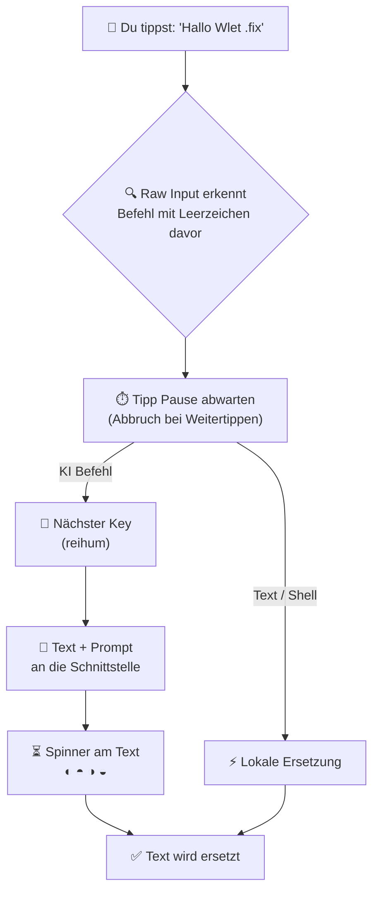

<div align="center">

<br>


# SwiftSlateJMKEdition

### Systemweite KI Textbearbeitung für Windows

Schreib einen Befehl wie **`.fix`** ans Ende eines Textes, in jeder App, warte kurz, und der Text wird direkt ersetzt.

<br>

[](#-installation)
[](#-technik)
[](LICENSE)
[](https://github.com/codingismynewgaming/SwiftSlateJMKEdition/releases/latest)

<br>

[](#-installation)
&nbsp;&nbsp;
[](https://github.com/codingismynewgaming/SwiftSlateJMKEdition/issues)

</div>

<br>

> [!NOTE]
> **Dies ist ein Fork.** SwiftSlateJMKEdition basiert auf [Musheer360/SwiftSlate-Desktop](https://github.com/Musheer360/SwiftSlate-Desktop) von [Musheer Alam](https://github.com/Musheer360).
> *This project is a fork of Musheer360/SwiftSlate-Desktop. All credit for the original idea and code goes to Musheer Alam.*
>
> **Herzlichen Dank an Musheer360** für das großartige Originalprojekt und dafür, dass er es unter der MIT Lizenz frei zur Verfügung stellt. Ohne seine Arbeit gäbe es diese Edition nicht. Wenn dir das Tool gefällt, gib bitte auch [dem Original](https://github.com/Musheer360/SwiftSlate-Desktop) einen ⭐.

<br>

## 📋 Inhalt

- [Kurz gezeigt](#-kurz-gezeigt)
- [Funktionen](#-funktionen)
- [Installation](#-installation)
- [Bedienung](#%EF%B8%8F-bedienung)
- [Befehle](#-befehle)
- [KI Anbieter](#-ki-anbieter)
- [Konfiguration](#%EF%B8%8F-konfiguration)
- [Eigene Befehle](#%EF%B8%8F-eigene-befehle)
- [So funktioniert es](#-so-funktioniert-es)
- [Fehlersuche](#-fehlersuche)
- [Datenschutz und Sicherheit](#-datenschutz-und-sicherheit)
- [Technik](#-technik)
- [Bekannte Grenzen](#%EF%B8%8F-bekannte-grenzen)
- [Mitmachen](#-mitmachen)
- [Lizenz und Dank](#-lizenz-und-dank)

<br>

## ⚡ Kurz gezeigt

```
Du tippst:   "ich hab das vergesen .fix"     (dann 1 Sekunde Pause)
Du siehst:   "ich hab das vergesen ◐"        (Spinner läuft)
Ergebnis:    "Ich habe das vergessen."
```

```
Du tippst:   "Hallo, wie geht es dir? .en"
Ergebnis:    "Hello, how are you?"
```

```
Du tippst:   "Heute ist .datum"
Ergebnis:    "Heute ist Dienstag, 24. November 2026"
```

<br>

## ✨ Funktionen

| | Funktion | Beschreibung |
|:--|:--|:--|
| 🌐 | **Überall nutzbar** | Erkennt Befehle systemweit über die Windows Raw Input API, in Browser, Editor, Messenger und anderen Apps. |
| ⌨️ | **Sichere Auslösung** | Befehl ans Textende mit Leerzeichen davor: `Text .fix`. Satzpunkte, `z.B.`, `3.5`, `notiz.txt` oder URLs lösen nicht aus. |
| ⏱️ | **Tipp Pause** | Der Befehl startet erst nach einer kurzen Pause (Standard 1 s, einstellbar 0 bis 5000 ms). Wer weitertippt, das Fenster oder den Fokus wechselt, bricht ab. |
| 🪟 | **Einstellungsfenster** | Grafische Oberfläche (tkinter) für Anbieter, Endpoint, Modell, Key, Präfix, Tipp Pause und Autostart. Öffnen per Klick auf das Tray Icon. |
| 🧩 | **Befehls Editor** | Befehle und Prompts direkt im Fenster anlegen, bearbeiten, umbenennen, sortieren und löschen, mit Prüfung auf Fehler. |
| 🤖 | **Freie Schnittstelle** | Jede OpenAI kompatible Schnittstelle (Cloud oder lokal, z. B. Ollama, LM Studio). Endpoint und Modell frei wählbar, Key optional. Gemini und Groq gehen ebenfalls. |
| 🔄 | **Hot Reload** | Änderungen an `config.json` und `commands.json` gelten nach etwa 2 Sekunden. Ist eine Datei fehlerhaft, bleibt der letzte gültige Stand aktiv, dazu kommt eine Meldung im Tray. |
| 🔁 | **Robuste Antworten** | Wiederholung bei HTTP 429 (mit `Retry-After`), Key Rotation, `<think>` Blöcke von Reasoning Modellen werden entfernt, `content: null` wird abgefangen. Der Originaltext bleibt bei Fehlern erhalten. |
| ↩️ | **Rückgängig** | `.undo` stellt den Text vor der letzten Ersetzung wieder her. |
| 🎨 | **Eigenes Icon** | Indigo Icon im Tray und im Einstellungsfenster, ab dem Start sichtbar, auch nach einem Explorer Neustart. |
| 📦 | **Geprüfter Installer** | Lädt vom Release Tag und prüft jede Datei per SHA256. Übernimmt Einstellungen und Befehle einer älteren Installation. |
| 🚀 | **Autostart** | Optional mit Windows starten, im Installer oder im Einstellungsfenster umschaltbar. |

<br>

## 🚀 Installation

**Voraussetzungen:** Windows 10 oder 11, Python 3.10+ mit tkinter (Installer von [python.org](https://www.python.org/downloads/windows/)). Fehlt Python, installiert der Installer Python 3.13 per `winget` im Benutzerkontext.

1. `Install-SwiftSlateJMKEdition.ps1` aus dem [neuesten Release](https://github.com/codingismynewgaming/SwiftSlateJMKEdition/releases/latest) herunterladen. Die Prüfsumme steht in `SHA256SUMS.txt`.
2. In einer **normalen PowerShell ohne Adminrechte** ausführen:

```powershell
cd $env:USERPROFILE\Downloads
Invoke-WebRequest -Uri https://github.com/codingismynewgaming/SwiftSlateJMKEdition/releases/download/v1.1.0/Install-SwiftSlateJMKEdition.ps1 -OutFile .\Install-SwiftSlateJMKEdition.ps1 -UseBasicParsing
(Get-FileHash .\Install-SwiftSlateJMKEdition.ps1).Hash   # mit SHA256SUMS.txt vergleichen
powershell -ExecutionPolicy Bypass -File .\Install-SwiftSlateJMKEdition.ps1 -Endpoint https://api.example.com/v1 -Model modellname
```

Bei einer Neuinstallation fragt der Installer den API Key verdeckt ab. Enter ohne Eingabe lässt ihn leer, z. B. für ein lokales Ollama.

**Weitere Aufrufe:**

```powershell
# Lokales Ollama ohne Key
.\Install-SwiftSlateJMKEdition.ps1 -Endpoint http://localhost:11434/v1 -Model gemma3:12b

.\Install-SwiftSlateJMKEdition.ps1 -SetKey          # nur den Key neu setzen
.\Install-SwiftSlateJMKEdition.ps1 -ResetConfig     # config.json neu schreiben
.\Install-SwiftSlateJMKEdition.ps1 -ResetCommands   # Standardbefehle wiederherstellen (alte Datei als .bak)
.\Install-SwiftSlateJMKEdition.ps1 -NoAutostart     # ohne Autostart
.\Install-SwiftSlateJMKEdition.ps1 -Uninstall       # entfernen
```

**Was der Installer macht:**
- Installiert nach `%LOCALAPPDATA%\SwiftSlateJMKEdition` (Programm in `app`, eigene Python Umgebung in `venv`).
- Lädt Programm, Befehle und Icon vom Release Tag und bricht bei falscher SHA256 Prüfsumme ab.
- Schützt `config.json` per Dateirechten, nur dein Benutzer kann sie lesen.
- Legt die Autostart Verknüpfung `SwiftSlateJMKEdition.lnk` an und startet die App.
- Erkennt eine ältere Installation unter `%LOCALAPPDATA%\SwiftSlate`, übernimmt `config.json` und `commands.json`, beendet die alte Instanz und entfernt deren Autostart. Der alte Ordner bleibt stehen und kann danach von Hand gelöscht werden.
- Mehrfach ausführen ist sicher. Bestehende Einstellungen und Befehle bleiben erhalten.

<br>

## 🖱️ Bedienung

| Aktion | Ergebnis |
|:--|:--|
| **Klick** oder **Doppelklick** auf das Tray Icon | Einstellungsfenster öffnet sich (ist es offen, kommt es nach vorn) |
| **Rechtsklick** auf das Tray Icon | Menü mit `Einstellungen…` und `Beenden` |
| Text tippen, dann ` .befehl` ans Ende, kurz warten | Text wird ersetzt |

Das Icon liegt im Infobereich neben der Uhr, eventuell hinter dem Pfeil `^`. Beim ersten Start ohne Einstellungen öffnet sich das Fenster von selbst.

**Einstellungsfenster, Reiter „Allgemein“:** Anbieter, Endpoint, Modell, API Key (wird nur maskiert angezeigt, neue Keys hinzufügen, alle Keys entfernen), Temperatur (0.0 bis 2.0), Präfix, Tipp Pause (0 bis 5000 ms), Autostart.

**Reiter „Befehle“:** Liste aller Befehle mit Typ. Name, Typ (KI, Text, Shell) und Prompt bzw. Wert bearbeiten. Buttons für Neu, Löschen, Nach oben, Nach unten. Gespeichert wird atomar, die laufende App übernimmt die Änderung per Hot Reload.

<br>

## 🧩 Befehle

### Standardbefehle (`commands.json`)

| Befehl | Typ | Beschreibung |
|:--|:--|:--|
| `.fix` | KI | Rechtschreibung, Grammatik und Zeichensetzung korrigieren |
| `.kurz` | KI | Text deutlich kürzen, Kernaussage und Sprache behalten |
| `.en` | KI | Text ins Englische übersetzen |
| `.de` | KI | Text ins Deutsche übersetzen |
| `.höflich` | KI | Text höflich und freundlich umformulieren |
| `.hoeflich` | KI | wie `.höflich`, ohne Umlaut |
| `.locker` | KI | Text locker und freundlich formulieren |
| `.besser` | KI | Klarheit und Lesefluss verbessern |
| `.mensch` | KI | Text natürlich und menschlich formulieren |
| `.antwort` | KI | Kurze, passende Antwort auf eine Nachricht schreiben |
| `.datum` | Shell | Aktuelles Datum einfügen, z. B. „Dienstag, 24. November 2026“ |
| `.zeit` | Shell | Aktuelle Uhrzeit (24 h) einfügen |

### Eingebaute Befehle

| Befehl | Wirkung |
|:--|:--|
| `.undo` | Text vor der letzten Ersetzung wiederherstellen |
| `.translate:XX` | In eine Sprache übersetzen, XX = Sprachcode mit 2 bis 5 Zeichen, z. B. `.translate:es` |
| `.copy` | Text vor dem Befehl in die interne Ablage kopieren |
| `.cut` | Text vor dem Befehl ausschneiden |
| `.paste` | Ablage hinter den Text einfügen (sonst Windows Zwischenablage) |
| `.replace` | Ganzen Text durch die Ablage ersetzen (sonst Windows Zwischenablage) |

<br>

## 🤖 KI Anbieter

| Anbieter | Hinweise |
|:--|:--|
| **OpenAI kompatible Schnittstelle** (Standard) | Beliebiger `/v1/chat/completions` Endpoint, z. B. `https://api.example.com/v1`, Ollama (`http://localhost:11434/v1`), LM Studio, vLLM. Modellname frei. Key optional. |
| **Google Gemini** | Key von [aistudio.google.com](https://aistudio.google.com/api-keys). Modelle werden gegen die Live Liste des Anbieters geprüft. |
| **Groq** | Key von [console.groq.com](https://console.groq.com/keys). Modelle werden gegen die Live Liste des Anbieters geprüft. |

> [!TIP]
> Mehrere Keys werden reihum genutzt. Ein Key mit HTTP 429 wird kurz pausiert, ein Key mit 401/403 für 15 Minuten übersprungen. Bei einem `http://` Endpoint außerhalb von localhost warnt die App, weil der Key dann unverschlüsselt übertragen wird.

<br>

## ⚙️ Konfiguration

Die Dateien liegen im Programmordner `%LOCALAPPDATA%\SwiftSlateJMKEdition\app`. Am einfachsten bearbeitest du sie über das Einstellungsfenster.

**config.json** (Beispiel ohne echte Daten, siehe `config.example.json`)

```json
{
  "api_keys": [],
  "provider": "custom",
  "endpoint": "https://api.example.com/v1",
  "model": "modellname",
  "temperature": 0.3,
  "prefix": ".",
  "trigger_delay_ms": 1000,
  "key_delay": 200,
  "spinner": "animated"
}
```

| Feld | Bedeutung |
|:--|:--|
| `api_keys` | Liste von API Keys, mehrere werden reihum genutzt. Bei `custom` darf die Liste leer sein. |
| `provider` | `custom` (OpenAI kompatibel), `gemini` oder `groq` |
| `endpoint` | Basis URL der Schnittstelle, nötig bei `custom` |
| `model` | Modellname |
| `temperature` | Kreativität, 0.0 bis 2.0 |
| `prefix` | Zeichen vor dem Befehl, Standard `.` |
| `trigger_delay_ms` | Pause nach dem Befehl in ms, 0 bis 5000, Standard 1000. Bei 0 löst der Befehl sofort aus. |
| `key_delay` | ms zwischen simulierten Tastendrücken, 30 bis 500, Standard 200. Auf langsamen Rechnern erhöhen. |
| `spinner` | `animated` (◐◓◑◒), `static` (`[Processing...]`) oder `off` |

<br>

## 🛠️ Eigene Befehle

Eigene Befehle legst du im Reiter „Befehle“ an oder direkt in `commands.json`:

```json
[
  { "trigger": "mail",   "type": "replacer-text",  "value": "du@example.com" },
  { "trigger": "uuid",   "type": "replacer-shell", "value": "powershell -NoProfile -Command \"[guid]::NewGuid()\"" },
  { "trigger": "punkte", "type": "ai",             "prompt": "Wandle den Text in eine Stichpunktliste um." }
]
```

| Typ | Wirkung | Braucht Key? |
|:--|:--|:--|
| `ai` | Sendet den Text mit deinem Prompt an die KI | je nach Anbieter |
| `replacer-text` | Ersetzt den Befehl durch festen Text, offline | Nein |
| `replacer-shell` | Führt einen Befehl aus und fügt die Ausgabe ein | Nein |

Reserviert sind `undo`, `copy`, `cut`, `paste`, `replace` und `translate`.

> [!CAUTION]
> **Shell Befehle laufen ohne Sandbox** mit deinen Benutzerrechten. Übernimm nie eine `commands.json` aus unsicherer Quelle.

<br>

## 🔧 So funktioniert es



<details>
<summary>🔧 <strong>Technische Details</strong></summary>

<br>

1. **Tastaturerfassung:** Ein verstecktes Fenster empfängt Tastatureingaben über die Windows Raw Input API.
2. **Erkennung:** Der längste passende Befehl am Ende des Puffers gewinnt. Davor muss ein Leerzeichen oder der Textanfang stehen.
3. **Tipp Pause:** Ein Timer wartet `trigger_delay_ms`. Ändern sich Puffer, Fenster oder Fokus, wird abgebrochen. Vor dem Ersetzen wird der Feldinhalt noch einmal geprüft.
4. **Puffer:** Er leert sich bei Fensterwechsel, Enter, Escape, Tab und Navigationstasten.
5. **KI Aufruf:** Läuft in einem eigenen Thread, Aufrufe werden nacheinander abgearbeitet. Der Text wird in `<input>` eingefasst, `<think>` Blöcke und Markdown Zäune werden entfernt.
6. **Ersetzen:** Strg+A und Strg+C lesen das Feld, Strg+V setzt das Ergebnis per SendInput ein.
7. **Zwischenablage:** Geschriebene Daten werden für Verlauf und Cloud Sync ausgeschlossen, soweit Windows das beachtet.
8. **Nur eine Instanz:** Eine Sperrdatei verhindert doppelte Starts.

</details>

<br>

## 🐛 Fehlersuche

```powershell
cd $env:LOCALAPPDATA\SwiftSlateJMKEdition\app
..\venv\Scripts\python.exe SwiftSlateJMKEdition.pyw --debug
```

Im Debug Modus läuft die App im Vordergrund und schreibt jede Erkennung, jeden API Aufruf und jeden Fehler in die Konsole und nach `debug.log`. Fehler beim Öffnen der Einstellungen landen auch ohne `--debug` in `debug.log` und erscheinen als Tray Meldung. Keys werden nie geloggt.

<br>

## 🔒 Datenschutz und Sicherheit

| | Thema | Umsetzung |
|:--|:--|:--|
| 👁️ | **Texterfassung** | Nur ein kurzer Puffer am Ende der Eingabe wird auf Befehle geprüft. Anderer Text wird weder gespeichert noch gesendet. |
| 📡 | **Datenübertragung** | Text eines KI Befehls geht nur an die eingestellte Schnittstelle. Nach einem Netzwerkfehler prüft ein reiner TCP Verbindungsaufbau zu 1.1.1.1 bzw. 8.8.8.8 (Port 443) die Verbindung. |
| 🔐 | **API Keys** | Liegen lokal in `config.json`, die der Installer nur für deinen Benutzer lesbar macht. Im Fenster werden Keys nie im Klartext angezeigt, in Meldungen nie Teile davon. |
| 📊 | **Analyse** | Keine. Keine Telemetrie, kein Tracking. |
| 🔑 | **Rechte** | Läuft als normaler Benutzerprozess, ohne Adminrechte. |
| ✅ | **Installer** | Fester Release Tag, SHA256 Pins für jede Datei, kein `irm \| iex`. CI prüft, dass die Pins zum Code passen. |

<br>

## 🏗️ Technik

<table>
<tr><td><strong>Sprache</strong></td><td>Python 3.10+, eine einzige Datei <code>SwiftSlateJMKEdition.pyw</code></td></tr>
<tr><td><strong>Abhängigkeiten</strong></td><td>Nur Standardbibliothek (<code>ctypes</code>, <code>urllib</code>, <code>json</code>, <code>threading</code>, <code>tkinter</code>)</td></tr>
<tr><td><strong>Eingabe</strong></td><td>Windows Raw Input API</td></tr>
<tr><td><strong>Tastensimulation</strong></td><td>SendInput</td></tr>
<tr><td><strong>Oberfläche</strong></td><td>Tray Icon (Shell_NotifyIcon), Einstellungsfenster mit tkinter</td></tr>
<tr><td><strong>Hot Reload</strong></td><td>Prüft die Änderungszeit der Dateien alle 2 Sekunden</td></tr>
</table>

<br>

## ⚠️ Bekannte Grenzen

- **Ersetzen per Strg+A / Strg+V:** Klappt in den meisten Textfeldern. In Apps mit eigener Eingabe (manche Terminals, Spiele Overlays) kann es scheitern.
- **Einzeiliger Puffer:** Der Befehl muss ohne Unterbrechung im selben Feld getippt werden.
- **Nur Windows:** Windows 10/11 ist nötig.

<br>

## 🤝 Mitmachen

Siehe [CONTRIBUTING.md](CONTRIBUTING.md).

```powershell
git clone https://github.com/codingismynewgaming/SwiftSlateJMKEdition.git
cd SwiftSlateJMKEdition
git config core.hooksPath .githooks     # hält die SHA256 Pins im Installer aktuell
python SwiftSlateJMKEdition.pyw --debug
python -m unittest discover -s tests -v
```

Fehler und Ideen bitte als [Issue](https://github.com/codingismynewgaming/SwiftSlateJMKEdition/issues) melden.

<br>

## 📄 Lizenz und Dank

MIT Lizenz, siehe [LICENSE](LICENSE). Das Copyright des Originals bleibt bei Musheer Alam.

Ein großes Dankeschön an [**Musheer Alam (Musheer360)**](https://github.com/Musheer360), den Autor des Originals [SwiftSlate-Desktop](https://github.com/Musheer360/SwiftSlate-Desktop) aus der [SwiftSlate](https://github.com/Musheer360/SwiftSlate) Familie. Wer seine Arbeit unterstützen möchte: [GitHub Sponsors](https://github.com/sponsors/Musheer360).

<br>

<div align="center">

SwiftSlateJMKEdition, ein Fork mit ❤️ für deutsche Texte

</div>
